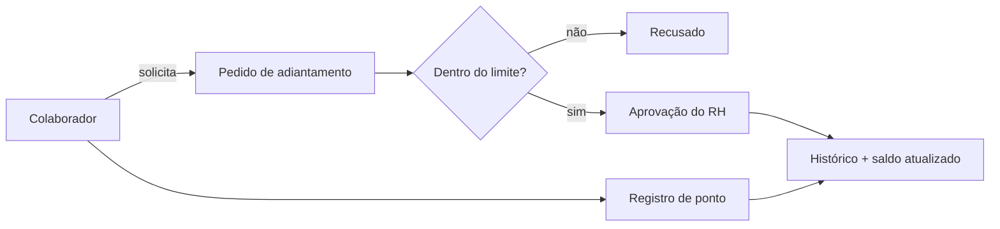

# Vale — adiantamento salarial sem planilha

[](https://github.com/in100tiva/mvp-vale/actions/workflows/ci.yml)
[](https://github.com/in100tiva/mvp-vale/actions/workflows/deploy-pages.yml)
[](https://in100tiva.github.io/mvp-vale/)
[](https://github.com/in100tiva/mvp-vale/releases)
[](LICENSE)


> **Em 30 segundos:** app web mobile-first que substitui planilha + WhatsApp no controle de **adiantamento salarial** ("vale"). O colaborador pede pelo celular, o RH aprova em dois toques e o limite de cada pessoa é recalculado na hora. O registro de ponto vive no mesmo app. Construído em **React 19 + Vite 8**, sem UI kit, com persistência local — a camada de API é o próximo passo do [roadmap](#roadmap).

**Demonstração:** https://in100tiva.github.io/mvp-vale/ — build publicado pelo workflow de Pages a cada push em `main`.

MVP web mobile-first para RH e colaboradores gerenciarem **adiantamentos salariais** e **registro de ponto** em um só lugar: solicitação, aprovação, limite disponível e histórico — sem depender de planilha ou troca de mensagens.

> Projeto de portfólio: front-end completo, persistência local e fluxo de aprovação. A camada de API é o próximo passo natural (ver [Roadmap](#roadmap)).

## O problema

Em operações pequenas, adiantamento salarial costuma viver em planilha + WhatsApp: o colaborador pede, o RH confere o limite, alguém aprova e o histórico se perde. O Vale modela esse fluxo como produto:

- **Colaborador** vê quanto já adiantou, quanto ainda pode pedir e o status de cada solicitação.
- **RH** vê a fila de pedidos, aprova ou recusa e acompanha o impacto no limite.
- **Ponto** fica no mesmo app, evitando dois sistemas para a mesma rotina.

## Funcionalidades

- **Dashboard** com saldo, limite e últimos pedidos
- **Pedidos de adiantamento**: criação, detalhe e mudança de status
- **Aprovação pelo RH** com histórico por colaborador
- **Registro de ponto** e espelho de horas
- **Equipe**: cadastro e perfil de cada colaborador
- **Navegação mobile** (bottom nav) e **sidebar no desktop**
- Persistência em `localStorage` com opção de reset — ideal para demonstrar o fluxo sem backend

## Fluxo



## Stack

| Camada | Escolha |
|---|---|
| UI | React 19 + JSX |
| Build/dev | Vite 8 |
| Estilo | CSS próprio, mobile-first |
| Estado | `useState` + hooks de persistência (`useLocalStorage`) |
| Dados | Mock estruturado em `src/data.js` |
| Qualidade | ESLint 10 (flat config) + GitHub Actions |

Sem biblioteca de estado, router ou UI kit: o objetivo era manter o MVP leve e legível.

## Rodando localmente

```bash
npm ci           # instala exatamente o que está no package-lock
npm run dev      # http://localhost:5173
npm run build    # build de produção em dist/
npm run preview  # serve o build localmente
npm run lint     # ESLint
```

Requisitos: **Node.js 20.19+** (ou 22.12+), exigência do Vite 8. O projeto usa **npm** (`package-lock.json` versionado).

## Scripts

| Script | O que faz |
|---|---|
| `npm run dev` | Servidor de desenvolvimento com HMR |
| `npm run build` | Build de produção em `dist/` |
| `npm run preview` | Serve o build de produção |
| `npm run lint` | Lint de todo o código-fonte com ESLint |

## Estrutura

```text
src/
├── App.jsx            # shell, navegação e composição das telas
├── screens.jsx        # dashboard, pedidos, equipe, perfil
├── forms.jsx          # novo pedido, novo funcionário, detalhe/aprovação
├── ponto.jsx          # registro e espelho de ponto
├── ui.jsx             # componentes base (avatar, sheet, toast)
├── toast.js           # contexto e hook do sistema de toasts
├── icons.jsx          # ícones em SVG
├── data.js            # dados iniciais e helpers (moeda, datas)
├── useLocalStorage.js # persistência e reset
└── styles.css         # design mobile-first
```

## Decisões de projeto

- **Persistência local em vez de backend** para validar o fluxo com usuários antes de investir em API.
- **Dados isolados em `data.js`** para trocar mock por chamadas HTTP sem reescrever as telas.
- **Componentes de formulário separados das telas** para o fluxo de aprovação não virar um componente gigante.
- **Contexto de toast em módulo próprio** (`toast.js`) para que `ui.jsx` exporte apenas componentes e o Fast Refresh continue confiável.

## Qualidade e automação

- **CI** (`ci.yml`): `npm ci` → lint → build em cada push e pull request para `main`.
- **Deploy contínuo do demo** (`deploy-pages.yml`): publica o build no GitHub Pages.
- **Dependabot** semanal para npm e GitHub Actions.
- **Análise de segredos** e *push protection* do GitHub habilitados no repositório.
- **Pull requests** com template e checklist; merges por *squash* com a branch apagada automaticamente.

## Roadmap

- [ ] API REST + PostgreSQL (pedidos, limites, ponto)
- [ ] Autenticação e papéis (colaborador / RH)
- [ ] Testes de fluxo (Vitest + Testing Library)
- [ ] Exportação de espelho de ponto (PDF/CSV)

Acompanhe o andamento nas [issues](https://github.com/in100tiva/mvp-vale/issues) e nos [releases](https://github.com/in100tiva/mvp-vale/releases).

## Contribuir

Sugestões, correções e melhorias são bem-vindas. Leia o [CONTRIBUTING.md](CONTRIBUTING.md) antes de abrir um pull request e use as [issues](https://github.com/in100tiva/mvp-vale/issues) para discutir mudanças maiores.

## Segurança

Encontrou uma vulnerabilidade? **Não abra issue pública.** Siga as instruções do [SECURITY.md](SECURITY.md) e use o canal privado de *security advisories* do GitHub.

## Licença

[MIT](LICENSE) © Luan Oliveira dos Santos
